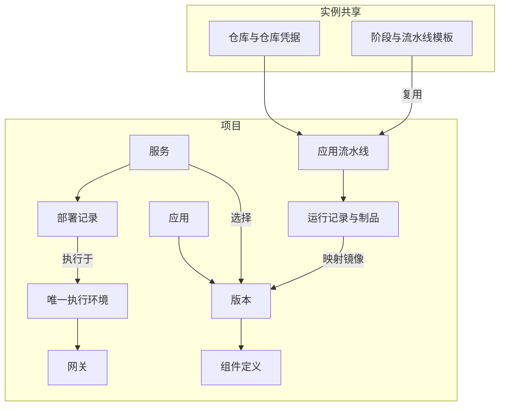

# 资源关系

先用下图确认资源归属，再进入各主题的操作页。

## 三组容易混淆的对象

| 对象 | 含义 | 示例 |
| --- | --- | --- |
| [项目](../guides/projects.md) / [环境](../guides/environments.md) | 成员和资源的归属 / 唯一执行目标 | 订单项目 / 一台 SSH 主机 |
| [应用](../guides/applications.md) / [版本](../guides/versions.md) / [组件](../guides/components.md) | 业务定义 / 某版配置 / 其中一个容器声明 | 订单系统 / `v1.0` / `api` |
| [服务](../guides/services.md) / [部署记录](../guides/deployments.md) | 长期运行绑定 / 一次操作 | `orders-main` / 本次升级 |

同一应用的多个服务可以选不同版本，但仍共用项目环境，需分别安排端口、目录和数据。

## 身份各管一处

| 身份 | 用途 |
| --- | --- |
| [仓库凭据](../guides/repository-credentials.md) | 获取源码，跨项目共享 |
| 环境 SSH 凭据 | 连接项目执行主机，归属环境 |
| [个人访问令牌](../guides/access-tokens.md) | 以用户身份调用本地 MCP / CLI |
| [Cloudflare Token](../guides/dns.md) | 管理授权 Zone 的 DNS 和 DNS-01 挑战 |

用户通过系统角色获得权限，通过项目成员关系获得项目访问资格。详见[角色与权限](../guides/roles.md)。
