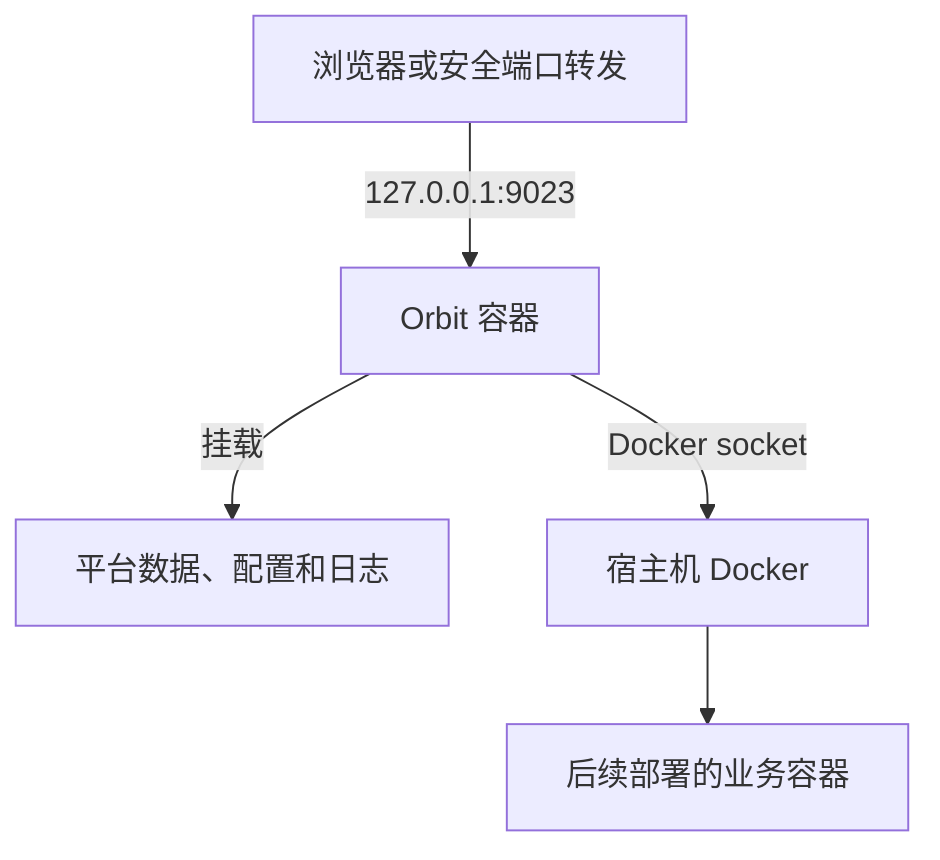

# 自托管运行

使用发布镜像或程序包运行 Pomelo Orbit，无需克隆源码或安装 Git、Go、Node.js、Python。本文以 Linux Docker 主机为例，使用 SQLite 保存平台数据，通过回环端口完成首次登录；程序包安装见[使用程序包](#使用程序包)。



## 选择安装方式

| 方式 | 获取的产物 |
| --- | --- |
| Docker 安装 | `ghcr.io/leoninew/pomelo-orbit` 发布镜像，或 Release 中对应架构的镜像归档 |
| 程序包安装 | Release 中与操作系统匹配的完整 ZIP 包 |

从 [GitHub Releases](https://github.com/leoninew/pomelo-orbit/releases)选择已发布版本。源码压缩包用于开发，不是运行包；需要修改源码或自行构建镜像时，见[本地开发](./development.md)。

## 安装前准备

- 一台 Linux 主机，已安装 Docker Engine 和 `docker compose`；以下终端命令使用 Bash，执行用户有 Docker 权限以及安装目录的读写权限。
- 能拉取发布镜像，或已取得对应架构的离线镜像归档；为镜像、日志和业务数据预留磁盘空间。
- 宿主机 `9023` 端口未被占用。下面只绑定 `127.0.0.1`；首次改密前不要公开入口。
- 一个**新的、无现有数据**的安装目录。已有实例应先完成[备份](../operations/backup.md)，再按[升级](../operations/upgrade.md)操作。

此路径把宿主机 Docker socket 交给 Orbit，意味着平台及有执行权限的用户能控制该 Docker 主机，接近宿主机管理员权限。不要将它当作不可信租户的安全沙盒；不要通过公开 Docker TCP 端口解决连接问题。

## 1. 获取运行镜像

将下方的 `vX.Y.Z` 替换为所选 Release 的版本标签，拉取镜像：

```bash
docker pull ghcr.io/leoninew/pomelo-orbit:vX.Y.Z
```

离线安装时，从同一 Release 下载 `linux-amd64` 或 `linux-arm64` 镜像归档并传到宿主机。例如 amd64 主机执行：

```bash
docker load --input pomelo-orbit-vX.Y.Z-linux-amd64.tar.gz
```

在线拉取和离线导入任选一种。Compose 使用同一个版本标签，后续升级保留旧镜像。

## 2. 准备运行目录和稳定密钥

在选定的安装父目录创建新的 `orbit-instance`。以下命令中的 `mkdir` 若提示目录已存在，先确认是否为已有实例，不覆盖其中的文件：

```bash
umask 077
mkdir orbit-instance && cd orbit-instance && mkdir data logs && touch .env overwrite.env
```

在 `.env` 中填写实例主密钥，将占位值替换为按[密钥管理](../operations/secrets.md#实例主密钥)生成的 Fernet 密钥：

```dotenv
POMELO_ORBIT_JWT__SECRET_KEY=replace-with-generated-fernet-key
```

安全备份 `.env`。这把密钥用于签名登录令牌和解密平台凭据；后续重启、容器重建、恢复数据库时使用原值。

## 3. 创建 Compose 配置

在 `orbit-instance` 中创建 `compose.yaml`，将镜像标签替换为第 1 步选择的版本：

```yaml
services:
  orbit:
    image: ghcr.io/leoninew/pomelo-orbit:vX.Y.Z
    restart: unless-stopped
    ports:
      - "127.0.0.1:9023:80"
    env_file:
      - .env
    environment:
      POMELO_ORBIT_SERVER__HOST: "0.0.0.0"
      POMELO_ORBIT_SERVER__PORT: "80"
      POMELO_ORBIT_DATABASE__URL: "sqlite:///data/db/pomelo-orbit.db"
      POMELO_ORBIT_WORKSPACE__ROOT: "/app/data"
      POMELO_ORBIT_LOGGING__DEPLOYMENT_ROOT: "/app/data/deployment-logs"
      POMELO_ORBIT_PROJECT_INITIALIZATION__ENVIRONMENT__LOCAL_WORKSPACE_ROOT: "/app/data/projects/first-example"
      POMELO_ORBIT_TURNSTILE__ENABLED: "false"
    volumes:
      - type: bind
        source: ./data
        target: /app/data
      - type: bind
        source: ./logs
        target: /app/logs
      - type: bind
        source: ./overwrite.env
        target: /app/overwrite.env
      - type: bind
        source: /var/run/docker.sock
        target: /var/run/docker.sock
```

各挂载的作用：

| 宿主机内容 | 容器内用途 | 保留要求 |
| --- | --- | --- |
| `data/` | SQLite 数据库、部署日志、配置恢复记录及放在其下的项目工作区 | 整体保留，不能只保留数据库文件 |
| `logs/` | 平台运行日志 | 按日志保留策略管理，反馈前脱敏 |
| `overwrite.env` | 系统设置保存的应用覆盖 | 必须预先是可写文件，不是目录；与 `data/config/` 一并保留 |
| Docker socket | 查询当前容器挂载并管理宿主机 Docker | 高权限入口，仅用于可信主机与可信使用者 |

不设置自定义 `hostname`，也不把本机 Docker socket 换成另一台主机的 Docker daemon：容器运行时需要查询自身挂载来映射路径。平台工作区和部署日志目录必须落在可映射的挂载内；项目初始化时也应使用 `/app/data/` 下独立目录，而不是容器内未挂载的家目录。

`overwrite.env` 的优先级高于 Compose 注入的环境。空文件适用于首次安装；以后修改 Compose 环境不能保证覆盖已保存的系统设置，详见[系统配置](../operations/configuration.md)。

此示例关闭 Turnstile，仅用于回环入口的隔离试用；没有配置 LLM、Google 登录或公网 TLS。不要把试用配置直接改成公网监听来交付生产服务。

## 4. 启动并检查安装结果

确认当前目录是 `orbit-instance` 后执行：

```bash
docker compose up -d
docker compose ps
docker compose logs --tail=100 orbit
```

`serve` 默认同时启动 Web 和后台 Worker，启动时自动执行数据库迁移。本例不另启 Worker，已有数据库的升级按[升级](../operations/upgrade.md)操作。

按以下顺序检查：

1. 容器没有持续退出或重启，日志没有配置、挂载、密钥或数据库迁移错误。
2. 从 Docker 宿主机浏览器访问 `http://127.0.0.1:9023/`，能够加载登录页面及静态资源。
3. 在其他电脑访问时，通过你已有的安全管理通道转发宿主机回环端口；其他电脑的 `127.0.0.1` 不是服务器，不要为首登临时开放公网管理入口。
4. 完成下一节登录和改密，退出后用新密码重新登录。

## 5. 首次登录并立即改密

当前版本在**全新数据库完成初始迁移后**创建的初始管理员使用：

| 字段 | 初始值 |
| --- | --- |
| 邮箱 | `admin@lvh.me` |
| 密码 | `admin@lvh.me` |

这是公开的初始化凭据，不是生产秘密。它不适用于已经改密、从其他实例恢复、种子数据不同或管理员已调整的数据库；升级也不会把密码重置成这个值。

1. 在尚未公开的入口登录，注意登录字段是邮箱，不是 `admin` 用户名。
2. 打开顶部用户菜单，选择“修改密码”，填写旧密码和新的独立强密码并保存。
3. 退出并使用新密码重新登录，保留可恢复的管理员访问方式。
4. 需要多人使用时，[创建账号](../guides/users.md)、[分配角色](../guides/roles.md)并[加入项目](../guides/projects.md)，不共享初始管理员。

登录失败时先核对所用版本、迁移是否完成和数据库路径。不要删除数据库重新试密码，也不要修改已执行的迁移或直接覆盖用户密码哈希。

## 使用程序包

从 Release 获取 Windows / Linux / macOS 的 x64 ZIP。程序包已包含编译后的前后端；镜像的 ARM 支持不代表原生程序包也支持 ARM。

1. 在新的专用目录解压完整包，保留 `configs/`、`static/`、启动脚本及 `VERSION`，不能只取可执行文件。记录包版本和可信来源。
2. 编辑包根目录的 `.env.release`，为新实例填写按[密钥管理](../operations/secrets.md#实例主密钥)生成的 `POMELO_ORBIT_JWT__SECRET_KEY`；已有实例使用原密钥，保留模板的其他配置。
3. 首次试用将 `POMELO_ORBIT_SERVER__HOST` 改为 `127.0.0.1`，保留端口 `9023`，确认 Turnstile 关闭。包模板原本监听所有接口，不应原样用于公开首登。
4. Linux / macOS 在包根目录执行 `bash ./pomelo-orbit.sh start`；Windows 运行包内的 `pomelo-orbit.cmd`。启动器会切换到包根目录并选择 `release` profile，读取 `.env.release`。如果另有 `overwrite.env`，先核对其最高优先级覆盖。
5. 程序以前台方式运行，不自动安装系统服务；后续按你的进程管理方案管理生命周期。按前面的检查和首登步骤验收；需要本机部署时，另行准备程序执行用户可用的 Docker / Compose。

在 WSL 中运行时使用与发行版匹配的 Linux 包及 Linux 路径，不把 Windows 包当作 Linux 程序，也不混用两侧的数据库、配置和 Docker 访问条件。

直接运行二进制不会替你选择 `release` profile 或切换工作目录。不要将启动器的 `status` 当作业务健康检查，也不要在仍有任务运行时使用 `restart`：停止流程可能在等待后强制结束进程。

## 安装失败时

| 症状 | 检查方向 |
| --- | --- |
| 缺少配置或页面空白 | 是否保留完整包，工作目录是否正确，是否错误挂载覆盖了 `/app/configs` 或 `/app/static` |
| 密钥为空或格式错误 | `.env` 是否被 Compose 注入、程序包是否读到 `.env.release`，是否被应用覆盖替换；不能用任意字符串代替 Fernet 密钥 |
| 工作区挂载或自身容器查询失败 | Docker socket、当前 Docker daemon、自定义 hostname、`/app/data` 挂载及路径配置 |
| SQLite 或覆盖文件无法写入 | 实际运行身份、目录 / 文件类型和权限，磁盘空间；不要通过删除数据库或放宽全部权限试探 |
| 端口已占用 | 先检查占用者，选择空闲宿主机端口并相应调整访问地址，不停止未知服务 |
| 迁移失败或 dirty 状态 | 保留日志与数据，由维护者核对版本和恢复方案，不手工跳过迁移或清除版本标记 |

安装完成后进入[部署首个应用](./first-deployment.md)；进一步排障见[故障定位](../operations/troubleshooting.md)。
