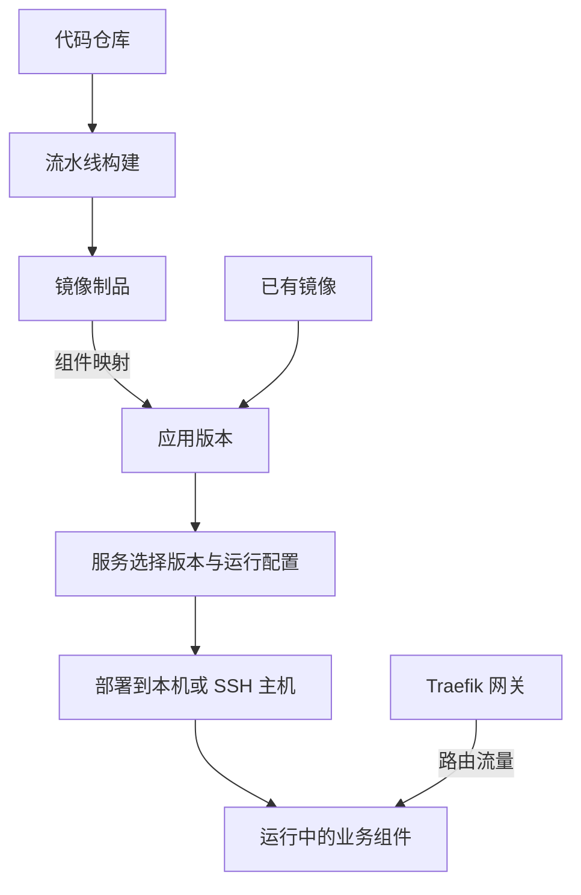

# 项目概览

Pomelo Orbit 是面向 Docker Compose 的自托管 CI/CD 平台。可以从源码构建镜像，也可以直接用已有镜像部署应用。

## 交付流程

构建链路与部署链路可分别使用。镜像制品生成版本后，由服务选择新版本并显式部署。

## 主要工作区

| 工作区 | 处理的任务 |
| --- | --- |
| 持续集成 | 登记源码，复用构建阶段与流水线，查看运行及制品 |
| 持续部署 | 声明应用，管理版本与服务，检查部署和网络入口 |
| 系统管理 | 维护项目、执行环境、用户、权限和实例设置 |

平台使用 Docker Compose 组织容器，适合希望统一管理版本、运行配置和部署记录的团队。执行主机需准备 Docker / Compose；SSH、仓库和网络能力按所用路径配置。

## 下一步

- 新实例：[自托管运行](./installation.md)。
- 已有实例：[部署首个应用](./first-deployment.md)。
- 查询对象归属：[资源关系](../concepts/core-model.md)。
- 修改平台源码：[本地开发](./development.md)。
