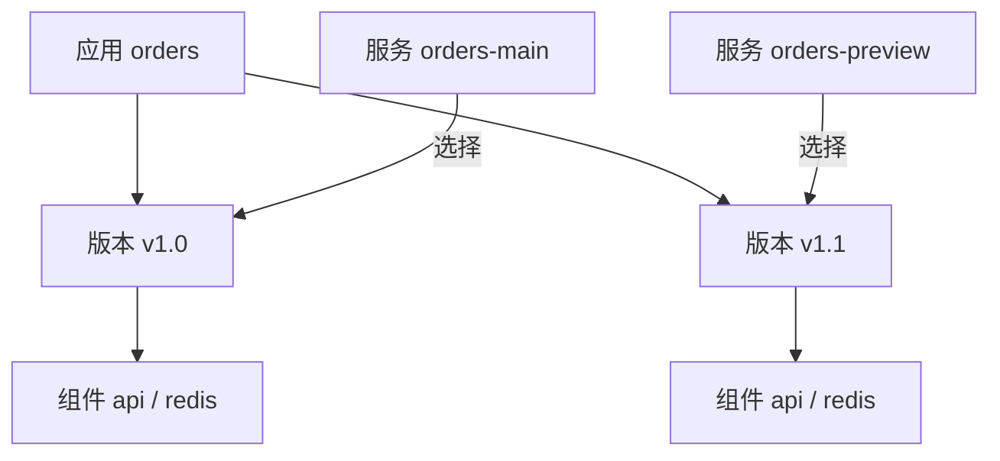

# 应用

应用是一组可部署内容的容器，例如订单系统 `orders`。它属于项目，通过[版本](./versions.md)保存组件定义，通过[服务](./services.md)建立实际运行绑定。

## 创建应用

1. 打开“持续部署 → 应用”，点击“创建应用”。
2. 填写名称和编码。编码以小写字母开头，只含小写字母、数字和连字符。
3. 创建后进入应用详情，打开自动生成的初始未发布版本，开始添加组件。

初始版本标签使用应用编码，内容为空。添加组件、配置版本、创建服务后才能部署。

此入口创建 `standard` 业务应用。系统托管的 Traefik 从[网关](./gateway.md)入口管理。

## 删除应用

仍有服务绑定时不能删除应用。先按[服务](./services.md)的生命周期处理运行资源和引用，再清理不再需要的定义。
