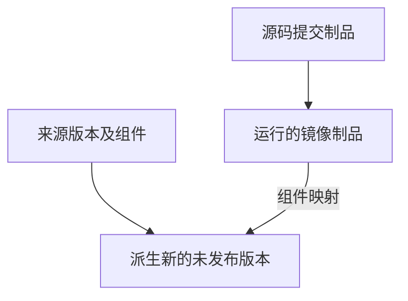

# 制品

制品是阶段声明并收集的输出，在运行记录或“持续集成 → 制品”中查看。

| 收集器 | 输出 | 检查点 |
| --- | --- | --- |
| `file` | 本次制品目录中的文件位置 | 缺失文件可能被警告并跳过，核对实际文件 |
| `command` | 收集命令的输出 | 格式选 `text` 或 `git_object_id`；后者为 40 或 64 位十六进制提交 ID |
| `docker_image` | 执行侧可检查的镜像引用及本地 SHA256 | 脚本先完成构建；跨主机使用还需推送并确认可拉取 |

制品详情可追溯仓库、流水线、阶段和运行编号。文件位置不一定是下载链接，本地镜像摘要也不能证明远程仓库已发布镜像。

## 将镜像汇入应用版本

在应用流水线中配置：

1. 选择业务应用与来源版本策略：`latest` 取创建运行时最新版本，`fixed` 取指定版本；来源可以是未发布版本。
2. 每个 Docker 镜像制品映射到来源版本已有组件。同一组件只能由一个镜像制品映射。
3. 镜像阶段的依赖链上需恰好一个 `command` / `git_object_id` 制品，输出真实源码提交。
4. 脚本构建镜像；全部阶段与绑定制品收集成功后，一次运行生成一个新的未发布版本。

到应用中核对生成版本和镜像，再由[服务](./services.md)选择并部署。新版本生成后，现有服务和容器保持原版本，直到显式更新。
