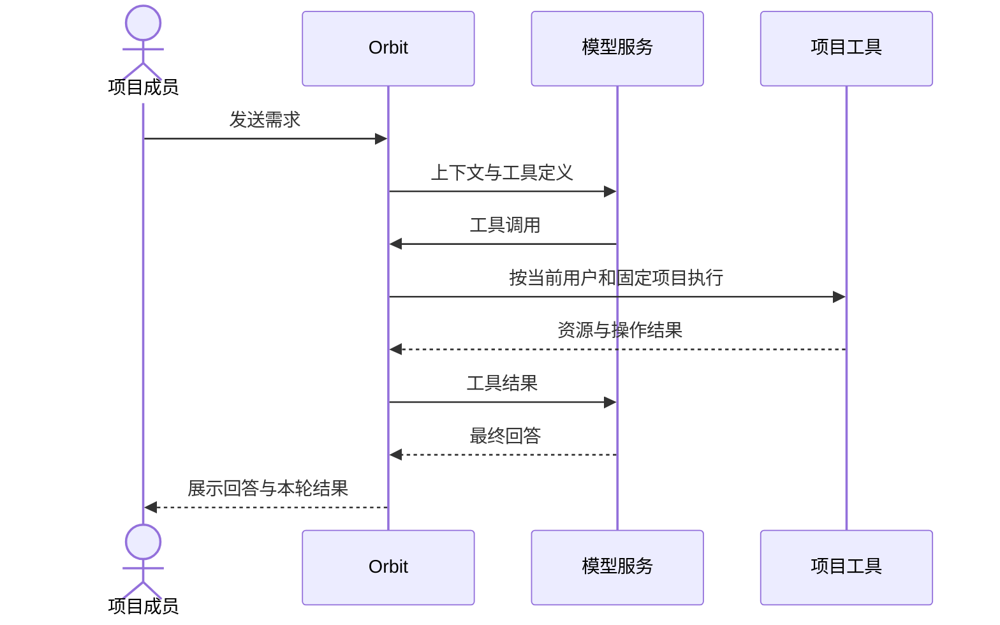

# 部署对话

部署对话让模型调用平台工具，查询或修改当前项目资源。它使用当前 Web 用户身份，无需另配个人 PAT。

## 启用模型

维护者在[系统配置](../operations/configuration.md)中成组配置：

| 键 | 内容 |
| --- | --- |
| `llm__base_url` | 基础地址，连接器追加 `/chat/completions` |
| `llm__api_key` | 供应商 Key |
| `llm__model` | 支持所需工具调用的模型标识 |
| `llm__timeout` | 单次模型请求超时，默认 `60s`，须为正 |
| `llm__max_tool_call_rounds` | 每轮模型循环上限，默认 `64`，至少为 `1` |

前三项全部为空表示关闭，部分填写会被拒绝。保存后按提示重新加载进程配置。模型请求包含上下文、工具定义和后续工具结果，选择允许处理这些数据的供应商。

## 发起对话

1. 确认当前项目，打开“持续部署 → 对话”。查看需 `dialogue:read`，发送、继续及删除需 `dialogue:write`，同时须为项目成员。
2. 点击“新对话”，或选择项目已有历史。
3. 写清资源标识、目标和允许的操作范围，发送并观察工具结果。
4. 返回资源详情，核对配置与本次部署记录。

::: warning 会执行真实操作
当前没有通用的逐项确认或强制只读开关。文字中的“只读”只表达意图，不能代替权限限制；上下文和工具结果也可能包含敏感信息。
:::

## 核对操作结果

修改版本后先回读，创建或修改服务后先预览，再部署。服务使用当前保存的版本绑定；集合类写入需提交完整集合。

工具完成只表示收到结果。返回 `deployment_id` 后检查[本次记录](./deployments.md)、容器和业务入口；等待工具超时后继续查询原记录。Web 对话等待上限为 10 分钟，与单次模型请求超时分别计算。

## 历史与中断

- 历史按项目共享，有权限的成员可查看、继续或删除；继续时使用当前发送者身份。
- 正常取得最终回答后保存用户与助手消息，历史不完整保存每次工具调用。
- 模型失败、断流或保存失败时，已发生的工具操作可能没有历史记录。保留资源与部署编号，先查询实际状态。
- 删除会话只清理历史，已提交部署、配置和 DNS 写入保持原结果。切换项目或关闭页面也不会取消旧操作。
