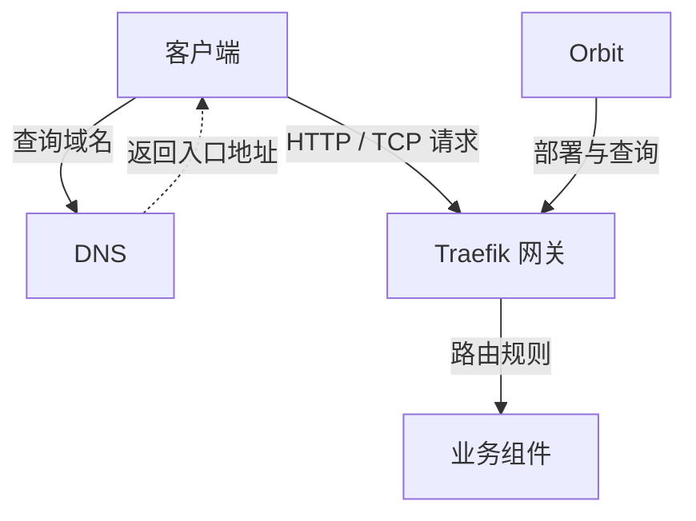

# 网关

项目环境关联一个受管 Traefik 网关，负责把入口流量转给下游服务。

DNS 返回地址，路由决定下游，服务提供实际响应。配置与检查分别在对应页面完成。

## 保存网关定义

在项目初始化的“准备网关”创建，之后在“持续部署 → 网关”维护。

| 配置 | 用途 |
| --- | --- |
| 内网域名 | 派生组件入口域名；不会自动创建 DNS 记录 |
| 外网域名 | 可选，自定义路由表单优先用它建议域名 |
| 容器 Traefik API URL | 本机目标且后端容器运行时使用，从后端容器侧访问 |
| 宿主机 Traefik API URL | 本机原生运行或 SSH 目标使用；SSH 在远端主机访问 |
| API 就绪超时 | 部署后等待管理 API 的时间，范围 1–300 秒 |
| HTTP 入口 / TLS 模式 | 组件入口默认策略，独立于自定义路由证书 |

管理地址使用 HTTP / HTTPS URL，不包含秘密。注意容器中的 `127.0.0.1` 指向容器自身。管理 API 保持受控访问，受管初始定义使用宿主机回环管理端口和 Docker socket。

## 部署与验证

1. 准备可信 Traefik 镜像，保存域名、API 地址及所需[证书能力](./certificates.md)。
2. 点击“部署”，确认目录、镜像拉取与强制重建选项。
3. 等待[部署记录](./deployments.md)结束，检查 Traefik 日志和管理 API。
4. 打开“Traefik 路由”查看实际加载规则，再从客户端验证业务入口。

创建网关定义只完成初始化。证书能力、Token 等运行配置更新后需重新部署网关；组件默认入口策略更新后，相关业务服务也需重新部署。

## 两种路由来源

| 来源 | 配置位置 | 生效动作 |
| --- | --- | --- |
| Docker provider | 组件 `gateway` 端点 | 服务加入 Traefik 网络并部署 |
| File provider | [自定义路由](./routes.md) | 保存、预览并确认同步 |

更改网关域名后，已有自定义路由和 DNS 仍需分别调整。停止网关会影响入口，但 DNS 记录和业务服务保持原状态。
