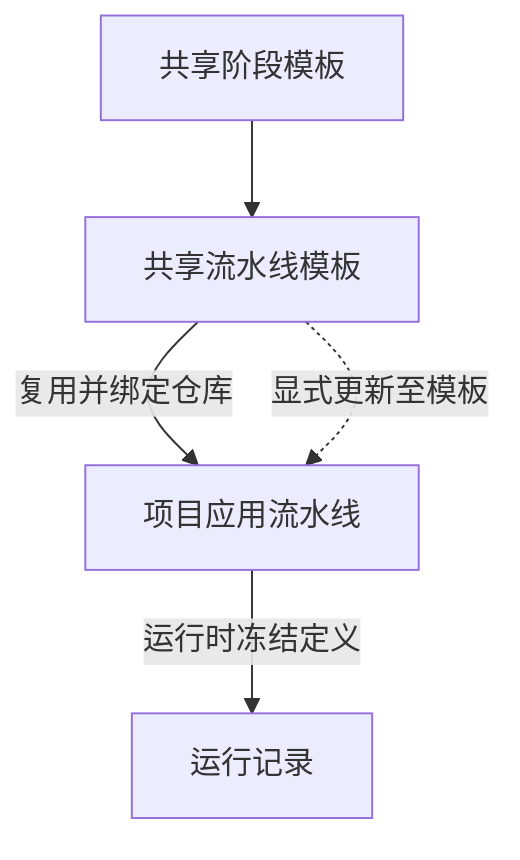

# 流水线

流水线模板组织可复用的阶段；应用流水线是项目内绑定仓库、可以提交执行的副本。“应用流水线”可以不绑定业务应用。

## 创建并复用

1. 准备[仓库](./repositories.md)和项目[执行环境](./environments.md)。SSH CI 需要 HTTPS 源码、受管凭据、主机指纹及 SSH CI 运行支持。
2. 在“持续集成 → 流水线”创建模板，添加[阶段](./stages.md)，设置依赖及变量。
3. 点击模板的“复用”，填写应用流水线名称、选择仓库，按需关联本项目的业务应用。
4. 核对新流水线的阶段、变量、来源模板版本及制品映射。
5. 点击“运行”，确认本次分支或标签，进入[运行记录](./runs.md)查看结果。

只做 CI 时，无需先部署网关。构建是否可执行仍取决于当前环境、源码、工具和镜像权限。

## 修改模板

修改共享模板后，已有项目副本保持原配置。需要采用更新时，点击“更新至模板”，预览差异并确认；随后核对私有配置和制品映射。历史运行快照保持原样。

## 关联应用版本

选择业务应用后，可把 Docker 镜像制品映射到来源版本的组件。运行成功后派生新版本的条件见[制品](./artifacts.md)。如果只需要执行脚本或收集文件，可不关联应用。

构建字段使用 Liquid，引用和优先级见[构建变量](../reference/ci-variables.md)。Git 认证与镜像仓库登录分别准备，阶段脚本负责实际构建和推送。
