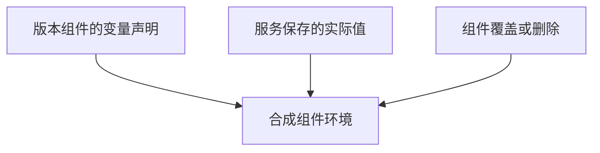

# 服务变量

服务变量保存运行绑定的实际值，版本组件通过完整占位符读取。只在服务中新增键，还需在使用它的组件中声明引用。

## 占位符规则

在**版本组件的环境值**中填写：

| 声明 | 解析结果 |
| --- | --- |
| `${KEY}` | 读取服务中的键，缺失或空串时报错 |
| `${KEY:?message}` | 同样要求存在且非空 |
| `${KEY:-fallback}` | 键缺失时用字面默认值；键存在但为空时保留空串 |
| `https://${HOST}/api`、`$KEY` | 保留原样，不进行部分替换 |

这里的 `:-` 空串行为与原生 Compose 不同。纯空白可通过非空检查，保存前自行核对。

服务键名使用 `^[A-Za-z_][A-Za-z0-9_]*$`，值原样保存，不继续解析嵌套引用。需要完整 URL 时，服务保存 `APP_URL=https://app.example.invalid/api`，组件声明 `${APP_URL}`。

## 组件运行覆盖

| 状态 | 最终环境值 |
| --- | --- |
| 继承 | 解析版本声明中的服务占位符 |
| 覆盖 | 使用覆盖的字面值，不再解析占位符 |
| 删除 | 省略这个环境键 |
| 恢复继承 | 移除覆盖，重新读取版本声明 |

空串覆盖会保留空值键。覆盖只能作用于版本已声明的环境键；新增组件、环境键或更换镜像通过版本管理。

## 生效与秘密

保存后先检查[服务预览](../guides/services.md)，再部署。镜像、命令、受控文件内容不使用这套占位符机制；环境值中 `$` 的处理见[Compose 生成规则](./compose.md)。

预览和部署文件可能包含解析后的秘密，分享前脱敏。数据库初始化凭据通常只在空数据卷生效，修改变量并重新部署不会轮换已有数据库密码。
